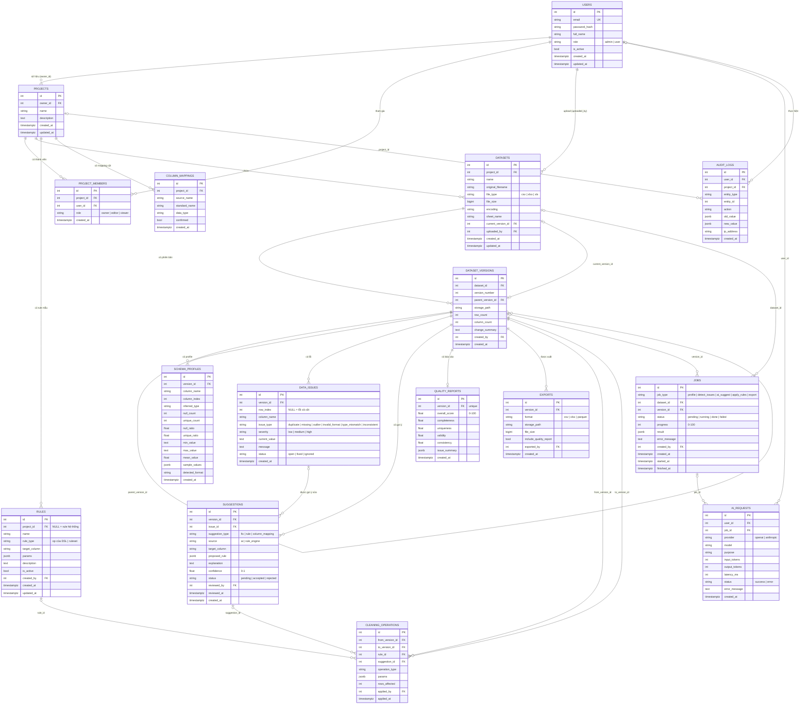
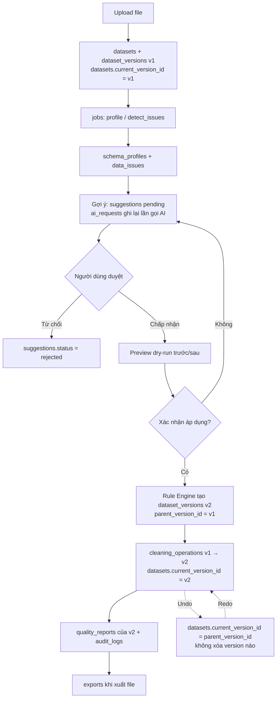

# Cơ sở dữ liệu

PostgreSQL 16, quản lý bằng SQLAlchemy 2.0 (`backend/app/models/`) và Alembic
(`backend/alembic/versions/`). **PostgreSQL chỉ lưu metadata**; dữ liệu từng dòng của mỗi phiên
bản nằm trong file Parquet trên object storage, được trỏ tới bởi `dataset_versions.storage_path`.

Schema hiện tại = `0001_initial_schema` + `0002_complete_schema` (16 bảng nghiệp vụ + `alembic_version`).

## Quy ước

- Khóa chính `Integer` tự tăng (`id`).
- Enum dùng cột `String` + `CheckConstraint` (không dùng PostgreSQL ENUM) để dễ migrate.
- JSON dùng `JSONB`; thời gian dùng `timestamptz` với `server_default = now()`.
- Mọi khóa ngoại có index và khai báo `ondelete` rõ ràng (xem từng bảng).
- `audit_logs` chỉ ghi thêm: xóa user/project chỉ làm `user_id`/`project_id` thành `NULL`, dòng log vẫn còn.

## Danh sách bảng

| Bảng | Mục đích | Ghi chú chính |
|---|---|---|
| `users` | Tài khoản | `email` unique; `role` ∈ `admin`/`user` |
| `project_members` | Thành viên project | unique `(project_id, user_id)`; `role` ∈ `owner`/`editor`/`viewer`. Hiện chỉ lưu dữ liệu, kiểm quyền vẫn dựa vào `projects.owner_id` |
| `projects` | Dự án làm sạch | `owner_id` → users (CASCADE) |
| `datasets` | File đã upload | `current_version_id` → phiên bản đang dùng (SET NULL); `file_type` ∈ `csv`/`xlsx`/`xls` |
| `dataset_versions` | Các phiên bản dữ liệu | unique `(dataset_id, version_number)`; `parent_version_id` tự tham chiếu (SET NULL) |
| `schema_profiles` | Thống kê từng cột của một phiên bản | unique `(version_id, column_name)`; có cả `null_count/unique_count` và `null_ratio/unique_ratio` |
| `data_issues` | Lỗi do detector phát hiện | `row_index = NULL` nghĩa là lỗi cả cột; `issue_type`, `severity`, `status` có CHECK |
| `suggestions` | Gợi ý của AI / rule engine chờ duyệt | `suggestion_type` ∈ `fix`/`rule`/`column_mapping`; `source` ∈ `ai`/`rule_engine`; `confidence` 0–1; `issue_id` → data_issues (SET NULL) |
| `rules` | Rule lưu lại để tái sử dụng | `project_id = NULL` là rule hệ thống; xem mục [Rule và DSL](#rule-và-dsl) |
| `cleaning_operations` | Một lần áp dụng rule: `from_version_id` → `to_version_id` | Có `rule_id`/`suggestion_id` (SET NULL) để truy nguồn gốc |
| `column_mappings` | Ánh xạ tên cột nguồn → tên chuẩn của project | unique `(project_id, source_name)`; `confirmed` khi user duyệt |
| `quality_reports` | Điểm chất lượng của một phiên bản | `version_id` **unique** (mỗi phiên bản một báo cáo); các điểm 0–100 |
| `jobs` | Tác vụ nền | `job_type`, `status`, `progress` 0–100 có CHECK |
| `ai_requests` | Nhật ký gọi AI (chỉ metadata) | Không lưu API key hay dữ liệu người dùng |
| `exports` | Lịch sử xuất file | `format` ∈ `csv`/`xlsx`/`parquet` |
| `audit_logs` | Nhật ký thao tác | `entity_type`/`entity_id`, `old_value`/`new_value` (JSONB), `ip_address` |

### Hành vi khi xóa (`ondelete`)

| Khi xóa | Hệ quả |
|---|---|
| `users` | Xóa các `projects` và `project_members` của user (CASCADE); các cột `created_by`/`uploaded_by`/`user_id`/... ở bảng khác thành `NULL` |
| `projects` | Xóa `datasets`, `rules` của project, `project_members`, `column_mappings`, và kéo theo toàn bộ dữ liệu con của dataset; `audit_logs.project_id` thành `NULL` (log được giữ) |
| `datasets` | Xóa `dataset_versions` và `jobs` của dataset |
| `dataset_versions` | Xóa `schema_profiles`, `data_issues`, `suggestions`, `quality_reports`, `exports`, `cleaning_operations`, `jobs` liên quan; `parent_version_id` và `datasets.current_version_id` thành `NULL` |
| `rules`, `suggestions` | `cleaning_operations.rule_id`/`suggestion_id` thành `NULL` |
| `jobs` | `ai_requests.job_id` thành `NULL` |

## Sơ đồ quan hệ (ER)

## Luồng dữ liệu qua các bảng

Tóm tắt: **upload → phân tích (profile + phát hiện lỗi) → gợi ý → người dùng duyệt → preview → áp dụng
→ phiên bản mới → undo bằng cách đổi `current_version_id` về `parent_version_id`.** Mọi phiên bản cũ
được giữ nguyên nên redo và khôi phục đều không mất dữ liệu.

## Rule và DSL

`rules` lưu một rule theo cùng DSL với Rule Engine (`app.schemas.rule.RuleSet`, xem [rule_dsl.md](rule_dsl.md)):

| Rule | `rule_type` | `target_column` | `params` |
|---|---|---|---|
| Một bước | tên `op` của bước (ví dụ `change_case`) | `column` của bước | `params` của bước |
| Nhiều bước (hoặc rỗng) | `ruleset` | `NULL` | toàn bộ RuleSet: `{"steps": [...]}` |

`CHECK` của `rules.rule_type` gồm đúng `ALLOWED_OPS` của DSL cộng `ruleset`. Hàm chuyển đổi:
`rule_set_to_columns` / `columns_to_rule_set` trong `app/schemas/rule.py`. Khi thêm op mới vào DSL phải
tạo migration cập nhật CHECK này; `test_rule_type_constraint_matches_dsl_and_migration` sẽ báo lỗi nếu
model, DSL và migration lệch nhau.

## Migration `0002_complete_schema`

Nâng cấp từ `0001` (cột đổi tên bằng `alter_column`, dữ liệu cũ được chuyển trước khi xóa cột):

| Bảng | Thay đổi so với 0001 |
|---|---|
| `datasets` | `created_by` → `uploaded_by` (nullable); thêm `file_type`, `file_size`, `encoding`, `sheet_name`, `current_version_id`, `updated_at` |
| `dataset_versions` | `version_no` → `version_number`; **xóa `is_current`** (backfill `datasets.current_version_id`, nếu nhiều bản `is_current` thì lấy `version_number` lớn nhất); thêm `column_count`, `change_summary` |
| `schema_profiles` | **Giữ** `null_ratio`/`unique_ratio`; thêm `null_count`/`unique_count` (backfill = `round(ratio × row_count)`), `column_index`, `min/max/mean_value`, `detected_format` |
| `suggestions` | `rule_json` → `proposed_rule`; **xóa `severity`** (nay ở `data_issues.severity`); `source` `rule` → `rule_engine`; thêm `issue_id`, `suggestion_type`, `target_column`, `confidence`, `reviewed_by`, `reviewed_at` |
| `rules` | `rule_json` tách thành `rule_type`/`target_column`/`params` (xem trên) rồi xóa; thêm `description`, `is_active`, `updated_at`; `project_id` nullable |
| `quality_reports` | `score` → `overall_score`, `metrics` → `issue_summary`; thêm 4 điểm thành phần; `version_id` unique (nếu trùng giữ bản mới nhất, có log cảnh báo); điểm ngoài 0–100 bị kẹp về khoảng hợp lệ |
| `audit_logs` | `dataset_id`/`before_version`/`after_version`/`detail` → `project_id`/`entity_type`/`entity_id`/`old_value`/`new_value`; thêm `ip_address`; `user_id` nullable |
| `projects`, `users` | Thêm `description` / `updated_at`; `users.role` có CHECK |
| Bảng mới | `project_members` (backfill owner từ `projects.owner_id`), `data_issues`, `cleaning_operations`, `column_mappings`, `jobs`, `ai_requests`, `exports` |

Lưu ý khi chạy:

- Nếu dữ liệu cũ có `(dataset_id, version_number)` hoặc `(version_id, column_name)` bị trùng, migration
  **dừng với thông báo rõ ràng** (không tự xóa dữ liệu) và vì DDL là transactional nên DB giữ nguyên ở `0001`.
- `downgrade()` dựng lại cấu trúc 0001 và dữ liệu (`is_current`, `rule_json`, các cột audit, ...).
  Cột `created_by`/`user_id` quay về `NOT NULL` nên downgrade sẽ lỗi nếu đã có dòng `NULL` (chủ ý).
  Dữ liệu chỉ có ở schema mới (`ip_address`, `confidence`, ...) bị mất khi downgrade; `suggestions.severity`
  được dựng lại từ lỗi gắn qua `issue_id` (nếu có), còn lại là `low`.
- Lệnh: `alembic upgrade head`, `alembic downgrade -1`, `alembic check` (xác nhận model khớp migration).
