# Sơ đồ hệ thống – Data Cleaning Platform

Tài liệu tập hợp các sơ đồ của dự án: kiến trúc, use case, ERD và các luồng xử lý.
Mọi sơ đồ viết bằng [Mermaid](https://mermaid.js.org/), xem trực tiếp trên GitHub hoặc bằng
preview Markdown của VS Code (cài thêm extension "Markdown Preview Mermaid Support" nếu chưa hiện hình).
Muốn đưa vào slide, mở sơ đồ trên <https://mermaid.live> rồi xuất PNG/SVG.

Mục lục: [1. Kiến trúc](#1-kiến-trúc-tổng-thể) · [2. Use case](#2-use-case) · [3. ERD](#3-erd-mô-hình-dữ-liệu) ·
[4. Các luồng](#4-các-luồng-xử-lý) · [5. Triển khai](#5-sơ-đồ-triển-khai)

---

## 1. Kiến trúc tổng thể

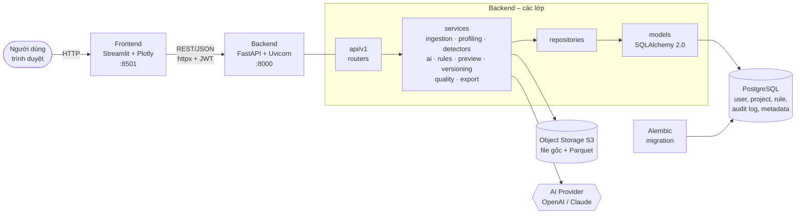

**Nguyên tắc cốt lõi:** AI chỉ sinh **rule JSON**; chỉ **Rule Engine (Pandas)** mới sửa dữ liệu thật,
và không bao giờ `exec()` mã do AI sinh.

---

## 2. Use case

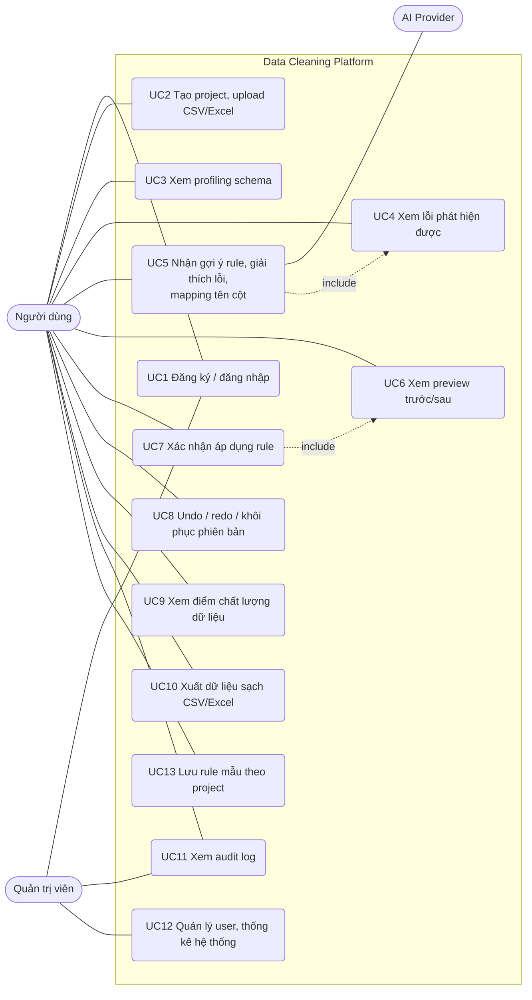

| Vai trò | Quyền |
|---|---|
| **User** | Làm việc trên project/dataset **của chính mình**; xem audit log của mình |
| **Admin** | Quản lý user (khóa/mở, đổi quyền, reset mật khẩu), xem thống kê và toàn bộ audit log |
| **AI Provider** | Hệ thống ngoài, chỉ trả về gợi ý dạng JSON |

---

## 3. ERD (mô hình dữ liệu)

Schema đầy đủ (16 bảng nghiệp vụ), sơ đồ ER dạng Mermaid, hành vi khi xóa và luồng dữ liệu qua các
bảng nằm ở **[database.md](database.md)** (nguồn: [backend/app/models/](../backend/app/models/) và
các migration `0001`, `0002`). Phiên bản đang dùng của dataset được xác định bởi
`datasets.current_version_id`, không còn cờ `is_current`.

---

## 4. Các luồng xử lý

### 4.1 Luồng tổng quát (end-to-end)

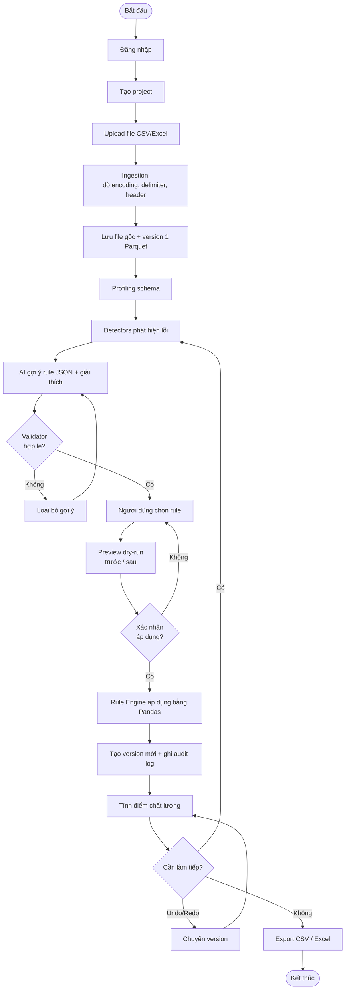

### 4.2 Đăng ký, đăng nhập và phân quyền

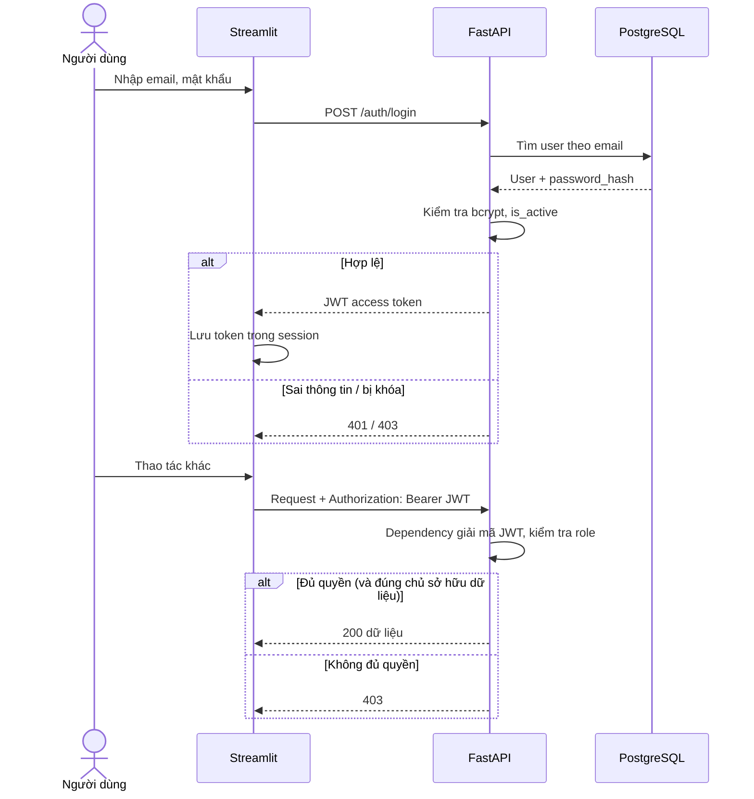

### 4.3 Upload và ingestion

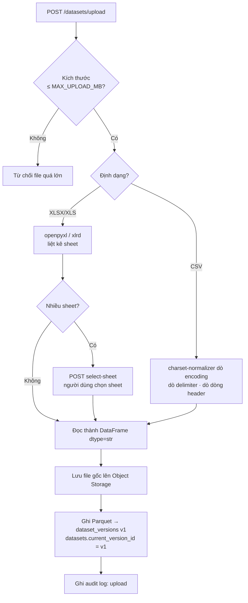

### 4.4 Profiling và phát hiện lỗi

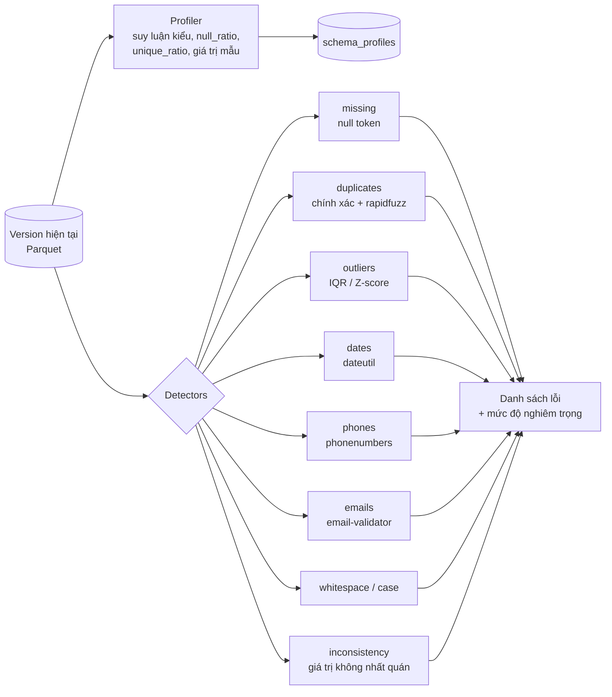

### 4.5 AI gợi ý rule và mapping cột

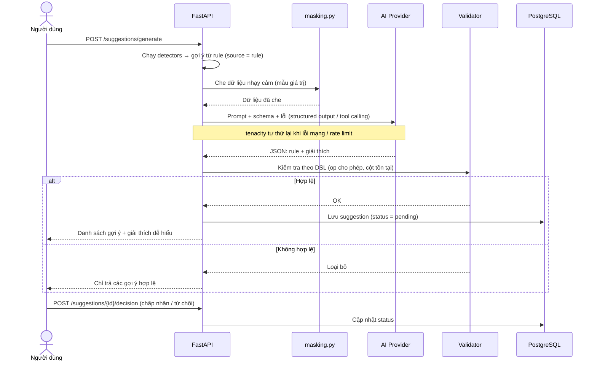

Mapping tên cột (`POST /api/v1/mapping/{version_id}/suggest`): chuẩn hóa tên cột (bỏ dấu bằng Unidecode, hạ chữ thường),
so khớp với bảng đồng nghĩa `column_synonyms.json` bằng rapidfuzz; phần chưa chắc chắn mới hỏi AI.

### 4.6 Preview và áp dụng rule

```mermaid
flowchart TD
    A[POST /preview<br/>rule_set + version_id] --> B[Validate RuleSet<br/>Pydantic + validator]
    B --> C[Đọc DataFrame từ Parquet]
    C --> D[Rule Engine dry_run<br/>trên BẢN SAO]
    D --> E[Bảng so sánh trước/sau<br/>+ số dòng/ô bị đổi]
    E --> F{Người dùng<br/>xác nhận?}
    F -- Không --> Z([Dừng, dữ liệu giữ nguyên])
    F -- Có --> G[POST /{dataset_id}/apply]
    G --> H[Rule Engine áp dụng thật]
    H --> I[Ghi Parquet mới → dataset_versions v+1<br/>parent_version_id = v]
    I --> J[Đặt datasets.current_version_id = v+1]
    J --> K[Ghi cleaning_operations + audit_logs:<br/>old_value, new_value]
    K --> L[Tính quality_reports]
```

### 4.7 Phiên bản, undo, redo, khôi phục

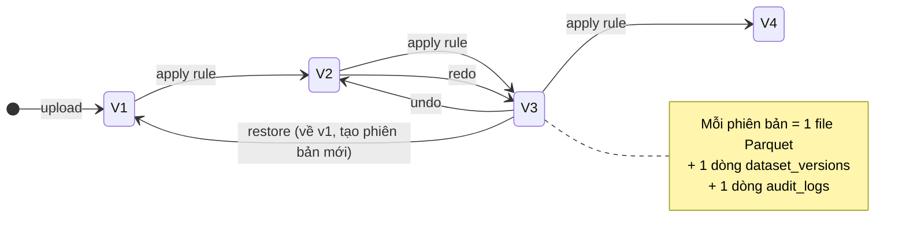

| Endpoint | Hành động |
|---|---|
| `POST /{dataset_id}/undo` | Chuyển về phiên bản cha |
| `POST /{dataset_id}/redo` | Tiến tới phiên bản sau đã undo |
| `POST /{dataset_id}/restore/{version_id}` | Khôi phục về một phiên bản bất kỳ |

### 4.8 Điểm chất lượng và xuất file

```mermaid
flowchart LR
    V[(Version hiện tại)] --> Q[quality.py<br/>tính các chỉ số]
    Q --> M1[Đầy đủ]
    Q --> M2[Hợp lệ]
    Q --> M3[Duy nhất]
    Q --> M4[Nhất quán]
    M1 & M2 & M3 & M4 --> S[Điểm tổng 0–100<br/>→ quality_reports]
    S --> UI[Plotly: đồng hồ điểm,<br/>biểu đồ missing, phân bố]
    V --> E{Export}
    E -->|GET /{version_id}/csv| C[File CSV sạch]
    E -->|GET /{version_id}/excel| X[File Excel sạch<br/>kèm điểm chất lượng]
```

Chi tiết công thức: [quality_score.md](quality_score.md).

### 4.9 Quản trị (Admin)

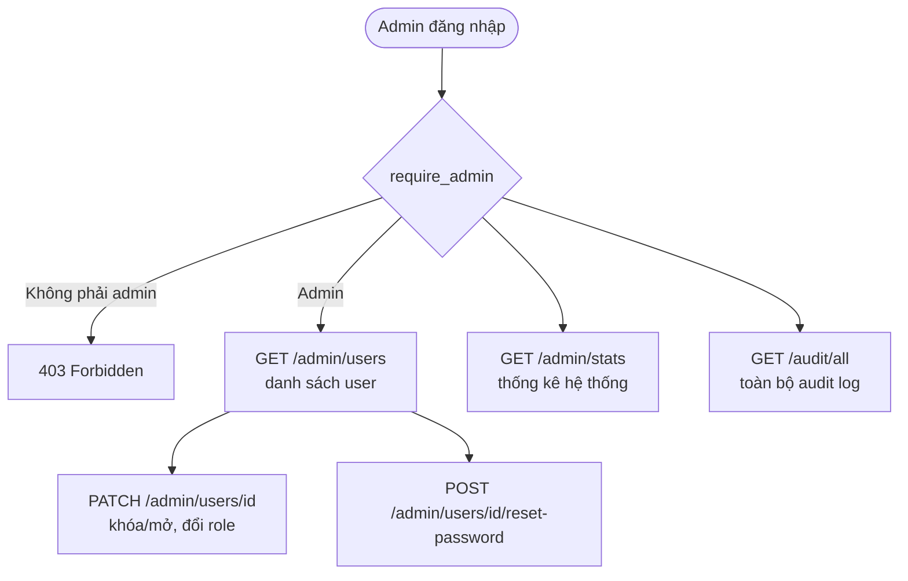

---

## 5. Sơ đồ triển khai

### 5.1 Chạy cục bộ (Docker Compose)

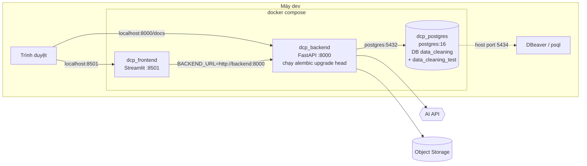

Thứ tự khởi động: `postgres` (healthy) → `backend` (healthy, sau migration) → `frontend`.

### 5.2 Môi trường online (mục tiêu của đề tài)

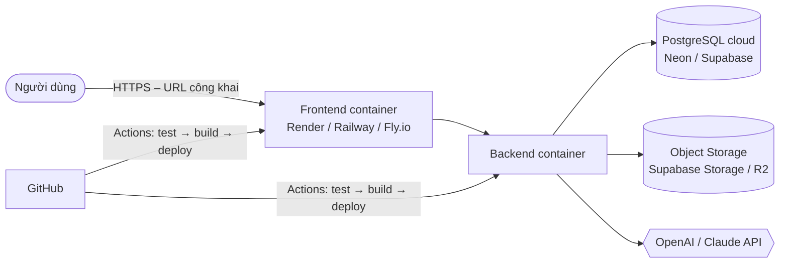

> Nền tảng deploy cụ thể chưa được chọn; sơ đồ 5.2 sẽ cập nhật khi chốt Render/Railway/Fly.io.
