# Sơ đồ hệ thống – Data Cleaning Platform

Tài liệu tập hợp các sơ đồ của dự án: kiến trúc, use case, ERD và các luồng xử lý.
Mọi sơ đồ viết bằng [Mermaid](https://mermaid.js.org/), xem trực tiếp trên GitHub hoặc bằng
preview Markdown của VS Code (cài thêm extension "Markdown Preview Mermaid Support" nếu chưa hiện hình).
Muốn đưa vào slide, mở sơ đồ trên <https://mermaid.live> rồi xuất PNG/SVG.

Mục lục: [1. Kiến trúc](#1-kiến-trúc-tổng-thể) · [2. Use case](#2-use-case) · [3. ERD](#3-erd-mô-hình-dữ-liệu) ·
[4. Các luồng](#4-các-luồng-xử-lý) · [5. Triển khai](#5-sơ-đồ-triển-khai) · [6. Trạng thái cài đặt](#6-trạng-thái-cài-đặt)

> **Cách đọc:** các sơ đồ mô tả **thiết kế mục tiêu** của hệ thống. Tên route, bảng, cột và cổng đã được
> đối chiếu với mã nguồn. Phần nào đã chạy được và phần nào còn là khung (stub) xem ở
> [mục 6](#6-trạng-thái-cài-đặt). Mọi đường dẫn API có tiền tố `/api/v1` (Swagger: `http://localhost:8000/docs`).

---

## 1. Kiến trúc tổng thể

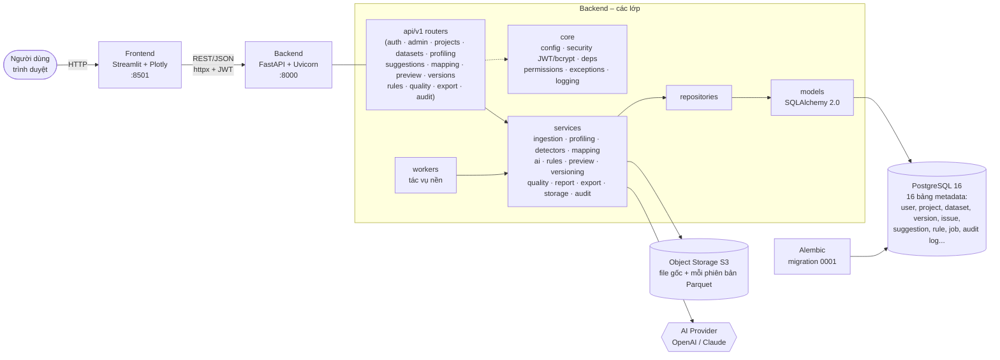

**Nguyên tắc cốt lõi:** AI chỉ sinh **rule JSON** (theo DSL `RuleSet`); chỉ **Rule Engine (Pandas)** mới sửa dữ
liệu thật, và không bao giờ `exec()` mã do AI sinh. PostgreSQL **chỉ lưu metadata**; dữ liệu từng dòng nằm
trong file Parquet trên object storage (`dataset_versions.storage_path`).

---

## 2. Use case

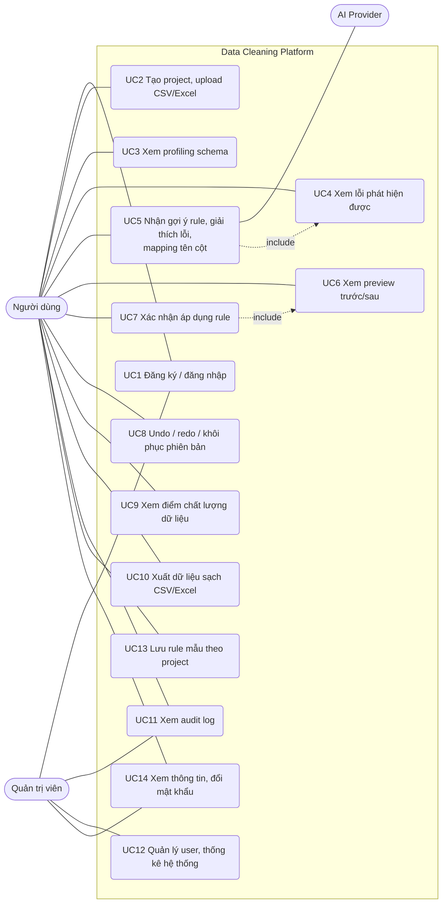

| Vai trò | Quyền |
|---|---|
| **User** | Làm việc trên project/dataset **của chính mình**; xem audit log của mình (`GET /audit/me`) |
| **Admin** | Thấy mọi project; quản lý user (khóa/mở, đổi quyền, reset mật khẩu), xem thống kê và toàn bộ audit log (`GET /audit/all`) |
| **AI Provider** | Hệ thống ngoài, chỉ trả về gợi ý dạng JSON; không được sửa dữ liệu |

Quyền project do `app.core.permissions.ensure_can_access_project` kiểm tra (admin hoặc `projects.owner_id`);
bảng `project_members` đã có sẵn để mở rộng chia sẻ project, hiện chưa dùng để kiểm quyền.

---

## 3. ERD (mô hình dữ liệu)

Schema đầy đủ (**16 bảng nghiệp vụ**), sơ đồ ER dạng Mermaid, hành vi khi xóa và luồng dữ liệu qua các
bảng nằm ở **[database.md](database.md)** (nguồn: [backend/app/models/](../backend/app/models/) và
migration `0001`). Phiên bản đang dùng của dataset được xác định bởi
`datasets.current_version_id`, không còn cờ `is_current`.

Tóm tắt các nhóm bảng:

| Nhóm | Bảng |
|---|---|
| Người dùng | `users`, `project_members` |
| Dữ liệu | `projects`, `datasets`, `dataset_versions`, `schema_profiles`, `column_mappings` |
| Lỗi và gợi ý | `data_issues`, `suggestions`, `rules`, `cleaning_operations` |
| Chất lượng, xuất file | `quality_reports`, `exports` |
| Tác vụ nền, AI, nhật ký | `jobs`, `ai_requests`, `audit_logs` |

---

## 4. Các luồng xử lý

### 4.1 Luồng tổng quát (end-to-end)

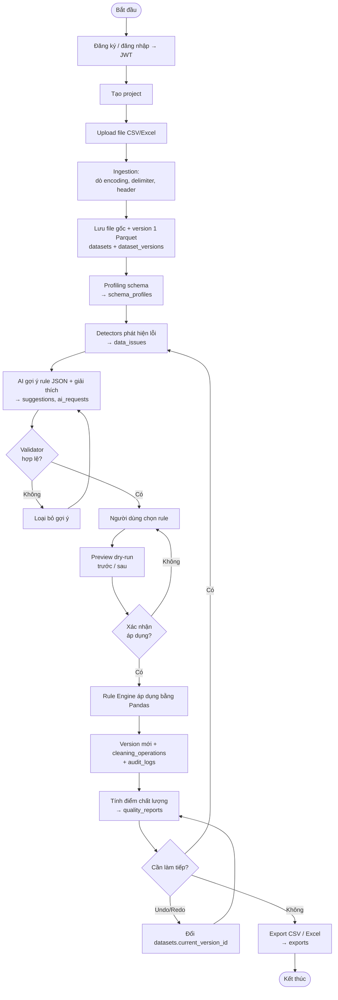

File lớn: profiling và phát hiện lỗi chạy nền (`app/workers`), tiến độ lưu ở bảng `jobs`
(`pending → running → done | failed`, `progress` 0–100) để giao diện hỏi lại trạng thái.

### 4.2 Đăng ký, đăng nhập và phân quyền

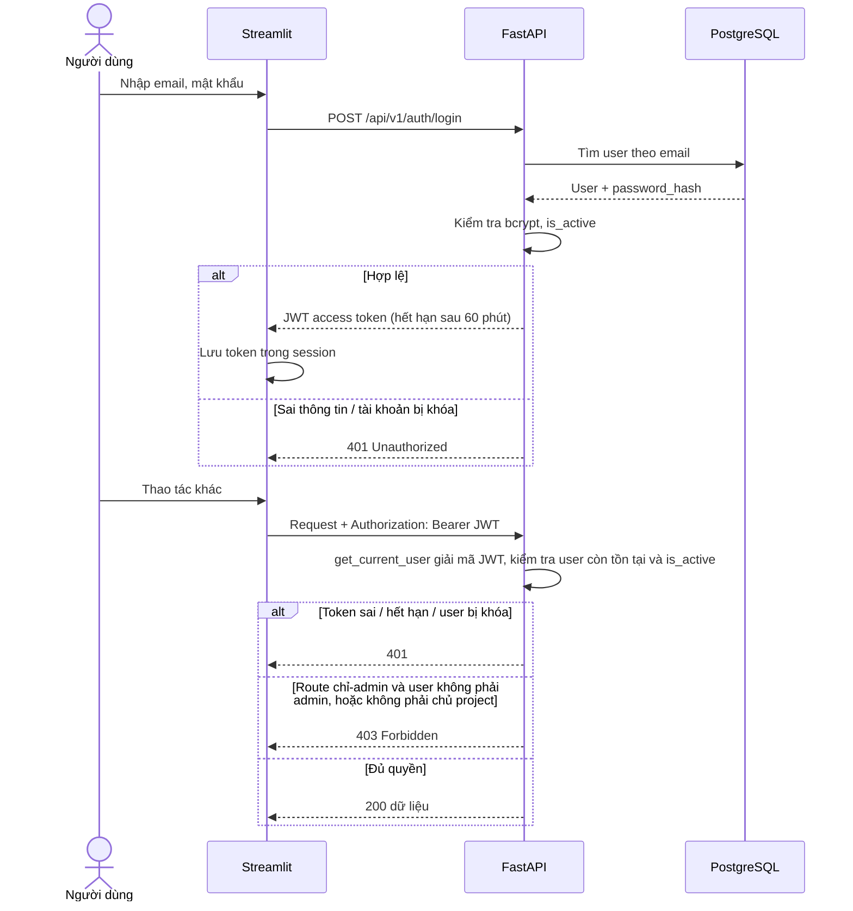

Đăng ký (`POST /auth/register`) luôn tạo role `user` (không tự đăng ký admin) và trả luôn token.
Admin đầu tiên tạo bằng `scripts/create_admin.py`.

### 4.3 Upload và ingestion

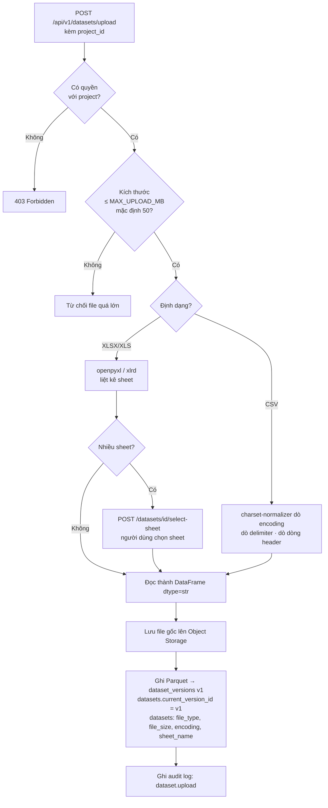

### 4.4 Profiling và phát hiện lỗi

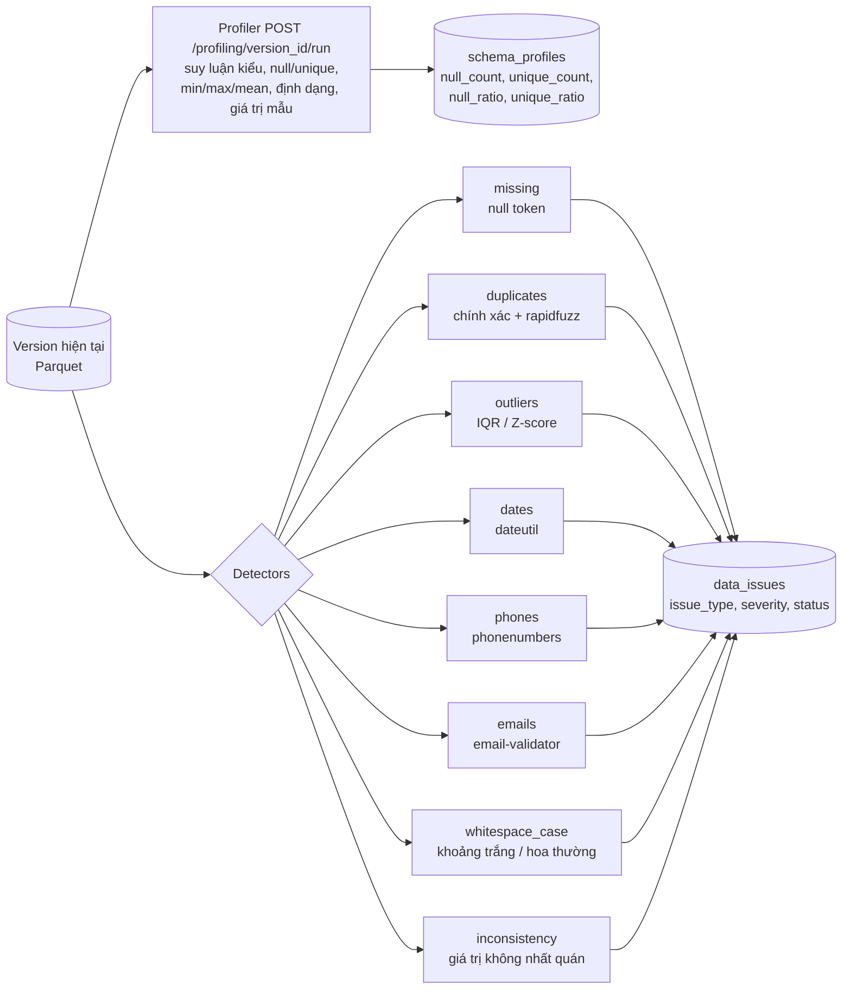

Ánh xạ detector → `data_issues.issue_type`:

| Detector | `issue_type` |
|---|---|
| missing | `missing` |
| duplicates | `duplicate` |
| outliers | `outlier` |
| dates, phones, emails | `invalid_format` |
| whitespace_case, inconsistency | `inconsistent` |
| suy luận kiểu (profiling) | `type_mismatch` |

`severity` ∈ `low` / `medium` / `high`; `row_index = NULL` nghĩa là lỗi ở mức cả cột; `status` ∈
`open` / `fixed` / `ignored`.

### 4.5 AI gợi ý rule và mapping cột

```mermaid
sequenceDiagram
    actor U as Người dùng
    participant BE as FastAPI
    participant M as masking.py
    participant AI as AI Provider
    participant V as Validator
    participant DB as PostgreSQL

    U->>BE: POST /api/v1/suggestions/generate
    BE->>BE: Chạy detectors → gợi ý từ rule (source = rule_engine)
    BE->>M: Che dữ liệu nhạy cảm (mẫu giá trị)
    M-->>BE: Dữ liệu đã che
    BE->>AI: Prompt + schema + lỗi (structured output / tool calling)
    Note over BE,AI: tenacity tự thử lại khi lỗi mạng / rate limit
    AI-->>BE: JSON: rule + giải thích + confidence
    BE->>DB: Ghi ai_requests (provider, model, token, độ trễ; không lưu API key hay dữ liệu)
    BE->>V: Kiểm tra theo DSL (op cho phép, cột tồn tại)
    alt Hợp lệ
        V-->>BE: OK
        BE->>DB: Lưu suggestions (source = ai, status = pending, issue_id nếu có)
        BE-->>U: Danh sách gợi ý + giải thích dễ hiểu
    else Không hợp lệ
        V-->>BE: Loại bỏ
        BE-->>U: Chỉ trả các gợi ý hợp lệ
    end
    U->>BE: POST /api/v1/suggestions/{id}/decision (accepted / rejected)
    BE->>DB: Cập nhật status, reviewed_by, reviewed_at
```

`suggestions.suggestion_type` ∈ `fix` / `rule` / `column_mapping`; `confidence` từ 0 đến 1. Mức độ nghiêm
trọng không nằm ở gợi ý mà ở lỗi gắn qua `issue_id` (`data_issues.severity`).

**Mapping tên cột** (`POST /api/v1/mapping/{version_id}/suggest`, body là danh sách cột chuẩn):

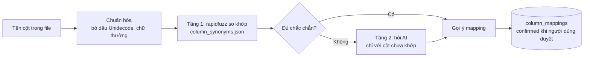

### 4.6 Preview và áp dụng rule

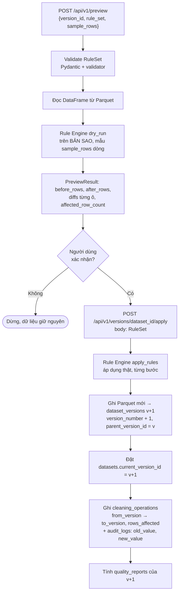

### 4.7 Phiên bản, undo, redo, khôi phục

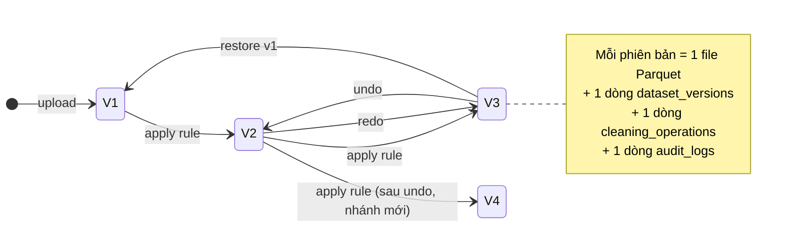

Undo, redo và restore **không tạo hay xóa phiên bản**; chúng chỉ đổi con trỏ `datasets.current_version_id`.
Chỉ `apply` mới tạo phiên bản mới.

| Endpoint | Hành động |
|---|---|
| `POST /api/v1/versions/{dataset_id}/undo` | Đặt `current_version_id` về `parent_version_id` của phiên bản hiện tại |
| `POST /api/v1/versions/{dataset_id}/redo` | Tiến tới phiên bản con gần nhất (`version_number` lớn nhất) của phiên bản hiện tại |
| `POST /api/v1/versions/{dataset_id}/restore/{version_id}` | Đặt `current_version_id` = một phiên bản bất kỳ trong lịch sử |
| `GET /api/v1/datasets/{dataset_id}/versions` | Danh sách phiên bản (cây phiên bản qua `parent_version_id`) |

### 4.8 Điểm chất lượng và xuất file

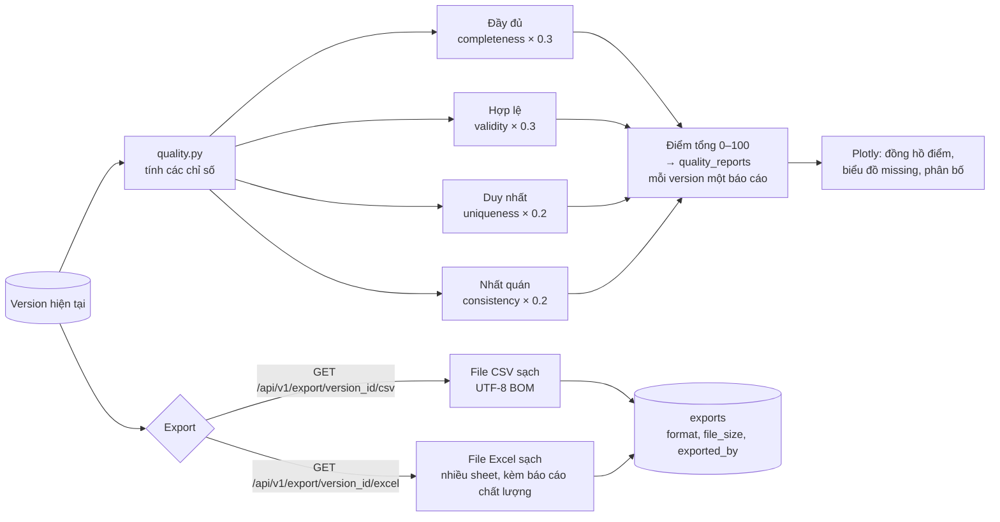

Đọc điểm: `GET /api/v1/quality/{version_id}`. Chi tiết công thức: [quality_score.md](quality_score.md)
(công thức tổng hợp đã có, phần chi tiết từng chỉ số còn TODO).

### 4.9 Quản trị (Admin)

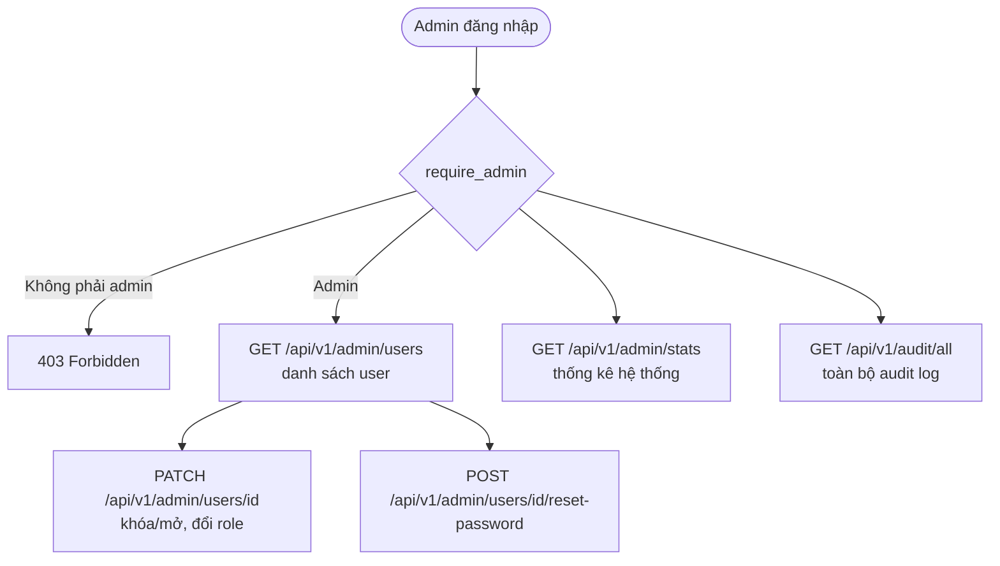

### 4.10 Bảng tổng hợp API (`/api/v1`)

| Nhóm | Endpoint |
|---|---|
| auth | `POST /auth/register` · `POST /auth/login` · `GET /auth/me` · `POST /auth/change-password` |
| admin | `GET /admin/users` · `PATCH /admin/users/{user_id}` · `POST /admin/users/{user_id}/reset-password` · `GET /admin/stats` |
| projects | `GET /projects` · `POST /projects` · `GET/PUT/DELETE /projects/{project_id}` |
| datasets | `POST /datasets/upload` · `GET /datasets/{id}` · `GET /datasets/{id}/versions` · `POST /datasets/{id}/select-sheet` |
| profiling | `POST /profiling/{version_id}/run` · `GET /profiling/{version_id}` |
| suggestions | `POST /suggestions/generate` · `GET /suggestions/by-version/{version_id}` · `POST /suggestions/{id}/decision` |
| mapping | `POST /mapping/{version_id}/suggest` |
| preview | `POST /preview` |
| versions | `POST /versions/{dataset_id}/apply` · `/undo` · `/redo` · `/restore/{version_id}` |
| rules | `GET/POST /rules/by-project/{project_id}` · `DELETE /rules/{rule_id}` |
| quality | `GET /quality/{version_id}` |
| export | `GET /export/{version_id}/csv` · `GET /export/{version_id}/excel` |
| audit | `GET /audit/me` · `GET /audit/all` (admin) |

Ngoài ra: `GET /health` (không có tiền tố `/api/v1`) dùng cho healthcheck.

---

## 5. Sơ đồ triển khai

### 5.1 Chạy cục bộ (Docker Compose)

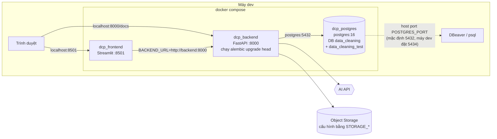

Thứ tự khởi động (có healthcheck): `postgres` (healthy) → `backend` (healthy, sau migration) → `frontend`.
Database `data_cleaning_test` do script `docker/postgres-init/01-create-test-db.sql` tạo cho pytest
(chỉ chạy khi volume còn trống).

### 5.2 CI/CD (GitHub Actions)

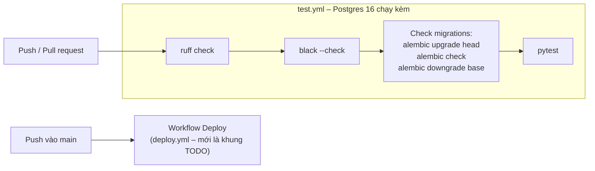

Bước *Check migrations* báo lỗi khi model SQLAlchemy và migration bị lệch nhau
(có thay đổi model nhưng chưa tạo migration).

### 5.3 Môi trường online (mục tiêu của đề tài)

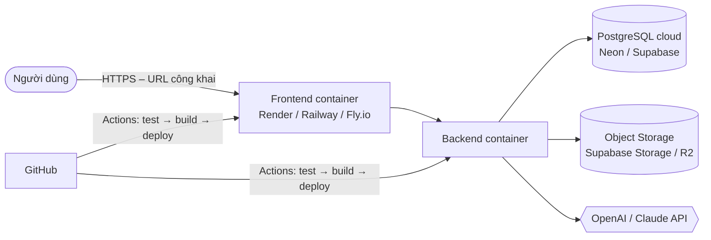

> Nền tảng deploy cụ thể chưa được chọn và `deploy.yml` mới là khung; sơ đồ 5.3 sẽ cập nhật khi chốt
> Render/Railway/Fly.io.

---

## 6. Trạng thái cài đặt

Đối chiếu với mã nguồn (cập nhật 04/11/2026). Ký hiệu: ✅ đã chạy được và có test · 🚧 chưa làm.

| Thành phần | Trạng thái |
|---|---|
| Hạ tầng: Docker Compose, healthcheck, `/health`, Swagger `/docs` | ✅ |
| CI `test.yml` (ruff, black, `alembic upgrade/check/downgrade`, pytest backend; ruff + pytest frontend) | ✅ |
| CI `deploy.yml` | 🚧 khung TODO |
| Database: 16 bảng, migration `0001` + `0003` + `0004`, `alembic check` sạch, test migration trên DB trống | ✅ |
| Model SQLAlchemy, schema Pydantic, DSL `RuleSet` + validator rule | ✅ |
| Hạ tầng dùng chung: lưu trữ local/S3, kiểm tra quyền sở hữu (`services/access`), xử lý lỗi, cấu hình an toàn | ✅ |
| Auth: đăng ký, đăng nhập (chặn dò mật khẩu 429), đổi mật khẩu, thu hồi token, `require_admin` | ✅ |
| Ingestion (CSV/Excel, dò encoding/delimiter/dòng tiêu đề, kiểm tra loại file, giới hạn kích thước) | ✅ |
| Profiling + 8 detector (thiếu, trùng, outlier, ngày, SĐT, email, khoảng trắng/hoa thường, biến thể giá trị) | ✅ |
| Mapping cột: tầng 1 (từ điển + rapidfuzz), tầng 2 bằng AI khi có khóa | ✅ |
| Gợi ý làm sạch: theo quy tắc; AI tùy chọn (che dữ liệu cá nhân, kiểm tra JSON, dự phòng về quy tắc) | ✅ |
| Rule Engine: đủ 13 op, preview (diff từng ô), apply / undo / redo / restore, rule template | ✅ |
| Điểm chất lượng (4 tiêu chí), xuất CSV/Excel (chống chèn công thức), xem dòng theo trang | ✅ |
| API: projects, datasets, profiling, suggestions, mapping, preview, versions, rules, quality, export, audit, admin | ✅ (toàn bộ) |
| Audit log: mọi thao tác ghi dữ liệu để lại một dòng cùng giao dịch | ✅ |
| Frontend Streamlit: 12 trang, chạy với backend thật (và chế độ dữ liệu mẫu `FRONTEND_MOCK=1`) | ✅ |
| Worker nền (`workers/tasks.py`), `column_mappings` / `target-schema` (endpoint #4, #5 chưa làm) | 🚧 |
| Deploy online có URL công khai | 🚧 |
